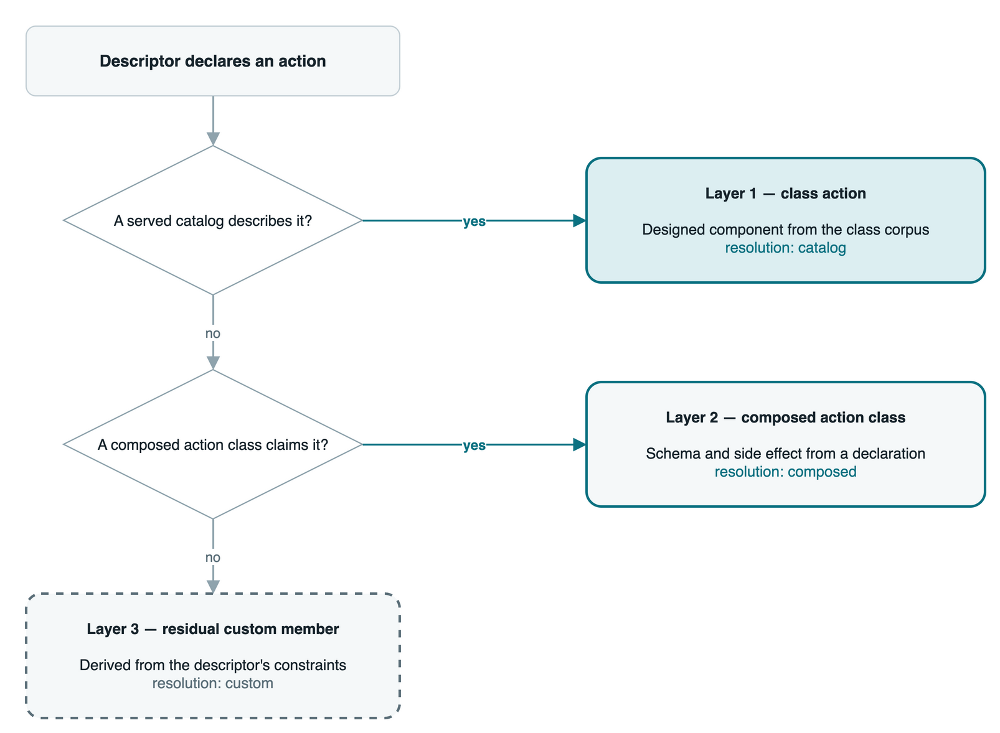
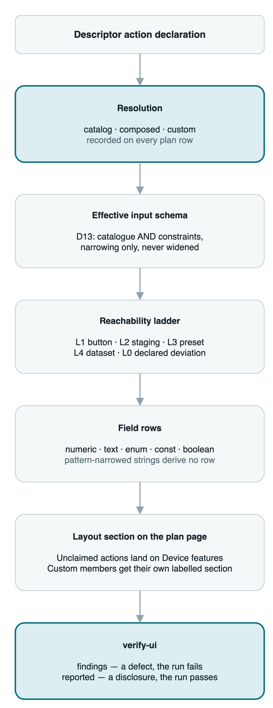
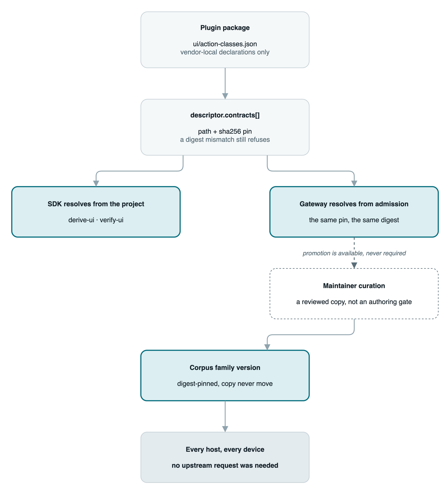

# Class-reference composition: three-layer action resolution

Maintainer architecture note for gateway issue #541 (slices 1–3, and this
documentation slice). It explains the mechanism the class-reference family and
the SDK expander now share — how a descriptor action resolves, where the
provenance of every control comes from, and which honesty rules keep the
no-refusal promise from becoming a silent-derivation promise. It is an
engineering record, not a normative surface: the normative text for the
composed documents is the corpus README sections "Composed action classes"
and "Composed member declarations"
(`standards/plugin-ui-class-reference/0.5.0/README.md`), and the design
arguments live in the records listed at the end. Cross-references replace
restatement here by design.

**Scope, extended 2026-10-26 (#556 Track B).** The note now covers two
layers of composition. Sections 1–8 describe the action layer, the
founding subject. Section 9 describes the member layer as it shipped: the
composed member declaration, the six vocabularies, the two-layer rule and
its residual disclosures, and the pin seam. Section 10 states the
deliberate divergences between the gateway and SDK derivations and the
convergence obligation each one carries. Nothing in sections 1–8 is
withdrawn by the extension; the deferral rows it closes are marked in
section 7.

Design records:

- `.claude/deep-review/2026-10-22-issue541-classref-composition.md` — the
  parent program record: the gap, the three layers, the honesty mechanism,
  the slices, and the deferral table (D1–D9) this note cites by id.
- `.claude/deep-review/2026-10-22-issue541-s2-standards-design.md` — the
  composed-action-class schema and the 0.4.0 family bump (the schema's closed
  sets and their derivations).
- `.claude/deep-review/2026-10-25-issue556-track-a-gateway-mirror.md` —
  the gateway mirror for composed and residual actions (#556 Track A).
- `.claude/deep-review/2026-10-25-issue556-track-b-vocabularies.md` — the
  six vocabularies and the composed member declaration (#556 Track B; its
  SDK-side copy ships at benchweave-sdk `v0.22.0`).
- `.claude/deep-review/2026-10-20-classref-composition-gate-design.md` — the
  cross-class composition gate (gateway issue #500).
- `.claude/deep-review/2026-10-16-classref-l5-plugin-ui-0-4-0-design.md` —
  the input-trio widening the ladder and field rows ride.

## 1. The problem the three layers solve

The class reference is a designed presentation per device class. It cannot
exhaust vendor operations: the long tail of a plugin's own verbs is open-ended
by construction, and every class reference is authored in isolation from the
plugins that will claim it. Before this increment, an action no served catalog
described was a hard stop — `derive-ui` raised `classref_unknown_action`. The
parent record's census (§1) locates the defect precisely: that one code was
raised from seven sites covering **two different conditions** — integrity
faults (a missing profile catalog, an unreadable or digest-mismatched pinned
document) and a recoverable knowledge gap (the descriptor declares an action
no catalog row describes). Conflating them meant a builder whose device was
mostly a class, with a handful of vendor features, was refused for a gap the
corpus was never going to close — a builder who had done nothing wrong, with
no path forward short of an upstream request.

The parent record's §1.1 finding bounds the increment: the refusal was the
*only* blocker. The derivation path for an uncovered action already existed —
the `vendor_actions` coverage slot, the device-features page, generic field
rows, generic control nodes — and the ladder already turned any input schema
into reachability plus field rows. So this is not a generic renderer added; it
is the removal of an assumption (every action has a catalogue row) plus an
honesty mechanism to replace the refusal's disclosure function.

## 2. The three layers

*Figure 1 — the resolution decision per declared action: a served catalog row
is layer 1 (`resolution: catalog`), a composed action class's claim is layer 2
(`resolution: composed`), and anything left is the residual layer 3
(`resolution: custom`). Editable source:
`assets/classref-layer-resolution.drawio`.*

- **Layer 1 — class actions (unchanged).** A descriptor action the served
  OTDP catalog or a pinned vendor catalog describes resolves exactly as
  before: the catalogue `input_schema` and the descriptor's `input_constraints`
  intersect (D13), and the ladder derives level and field kinds.
- **Layer 2 — composed action classes.** Mechanism, in one sentence: layer 2
  is layer 1 with the catalogue side supplied by a composed action-class
  declaration instead of the served catalog. A claim is an explicit versioned
  action key; the class document contributes `input_schema` and `side_effect`
  and nothing presentational. The claim joins the same `actions` map the
  catalog walk fills (the injection site in
  `packages/sdk/src/benchweave_sdk/classref.py::_vendor_documents`), so
  **D13, the reachability ladder and the field-row derivation are shared, not
  duplicated** — one intersection function (`_effective_action_schema`), one
  ladder (`_ladder_level`), one field-row derivation (`_field_rows`) runs for
  all three layers. The declaration asserts no component: the ladder keeps
  ownership of the component mapping, and the schema refuses a `component`
  field outright (the s2 record §3 derives this and the closed `side_effect`
  set from the axes the gate actually consumes).
- **Layer 3 — residual custom members (always on).** An action no catalog and
  no class claims derives from the descriptor's own `input_constraints`, which
  is already JSON Schema; the effective schema is the constraints alone (the
  `_effective_action_schema` residual mode), and the row lands on the
  device-features page through the existing vendor-actions arm. There is no
  flag and no opt-in: the acceptance scenario is a builder who does not know
  the class reference exists (parent record §3).

Two derivation refinements ride the same path and belong to no single layer:
the D13 intersection is narrowing-only on bounds (both sides value-typed
before comparison; an empty admittance refuses `classref_effective_schema_empty`),
with the parent record's B10 correction carried — `pattern` and `multipleOf`
take the constraint's value rather than intersecting it, a pre-existing
replacement this increment did not widen; and a residual action whose
`input_constraints` carries no `properties` key at all declares nothing, which
derives `L0` with a disclosure naming the absence rather than a one-click
button (the W7 fold: silence must not become dispatch).

## 3. Resolution through to the gate

*Figure 2 — the pipeline every declared action travels: the layer decision is
recorded on the plan row first, then the shared machinery (effective schema,
ladder, field rows, layout section) runs, and `verify-ui` separates findings
(a defect; the run fails) from reported rows (a disclosure; the run passes).
Editable source: `assets/classref-resolution-to-render.drawio`.*

The order is load-bearing: resolution is decided and recorded **before** the
shared machinery runs, so every downstream surface reads the same provenance
rather than re-deriving it. `verify-ui`'s two channels are the honesty
boundary the no-refusal promise rests on — a defect (a coverage miss, a
forbidden control) is a `findings` failure; a disclosure (a custom member, an
unapplied class, a deferred vocabulary member) is a `reported` row that never
fails a run and never disappears.

## 4. Provenance as data

Every control plan row carries `resolution: "catalog" | "composed" | "custom"`
— provenance is data in the derivation output, not a log line (parent record
§4.1). A composed row additionally carries `class` (the class URN, whose
suffix is the class's own version) and the class's declared `side_effect`.
The stamp is derived at exactly one point — the catalogue-row check in the
plan construction (`classref.py` plan build) — and every consumer reads the
row: the conformance ledger's inventories, the gate's read-back sets, the
`derive-ui` output. A reader can therefore trust which layer produced a
control because the label cannot be re-decided downstream, and because the
only writer of `composed` provenance is the composed walk itself (rule 1
below). What this does **not** catch: a future surface that derives controls
without reading the plan row would bypass the provenance entirely — the
pinning is on the current consumers (ledger, gate, read-backs), not on the
renderers' internals.

## 5. The honesty rules

Removing a fail-closed refusal without a replacement is the failure this
design refuses to commit; the rules below are the replacement, and each one
was taught by a specific defect rather than invented for symmetry.

**1. Composed provenance has exactly one writer.** The composed walk is the
only code path that writes `composed_class` onto an action row; a
vendor-catalog action row carrying a stray `composed_class` key is **stripped**
on read (`_vendor_documents`, the N2 fold). Defect that taught it: the
document-shape discriminator is conjunctive over top-level keys (`urn` AND
`claims`) and never inspects keys riding inside an action row, so a stray key
rode beside a `side_effect` into the D7-feeding plan row and could launder the
composed label — the review's disposition assumed the conjunctive test made
the strip unnecessary; it did not.

**2. The ledger records the classes the derivation applied, and both tools key
to that set.** `composed_classes` records the classes the derivation
*applied* — a class applies when at least one of its claims names an action the
descriptor declares (`_applied_class_urns`). Both `verify-ui` (the composed
read-back, `_composed_inventory_findings`) and `migrate-ui` (the drift
arithmetic in `_migrate_classref_ledger`, over `composed_ledger_inventory`)
key to exactly that set. Defects that taught it, both in the same field: the
drift arithmetic originally carried actions only, so a ledger whose
`composed_classes` rows were deleted passed both tools green and the next
family bump re-stamped the family stamps without re-resolving the now-unnamed
classes — silently losing the validation record (the s2 record §8 refute
correction); and keying to the pin-declared set instead refused
`migrate_ui_ledger_drift` against a ledger `derive-ui` had just written for a
sanctioned class whose claims name nowhere on this descriptor — the author's
re-derive looped on byte-identical output (the R1 fold).

**3. Four states are reported, never silent.** All four ride `verify-ui`'s
`reported` channel in both gate arms (the reference-less arm carries every
disclosure too — the B6/B7/R3 discipline):

| State | Disclosure | Defect that taught it |
|---|---|---|
| A pinned class that applied nowhere | `composed class <urn> is pinned (<path>) but its claims name no action this descriptor declares` | invisible before the row existed — and, per rule 2, simultaneously miscounted as drift (R1/B7) |
| An empty catalog pin | `pinned document <path> contributed nothing (its vendor-catalog actions map is empty)` | a shape-valid vendor catalog declaring no actions contributed nothing and said nothing (R5) |
| An ignored pin | `pinned document <path> contributed nothing` | a digest-verified pin matching neither shape was dropped silently; the same walk crashed on bare `AttributeError` for a non-object pin or a non-dict `actions` map before those faces were typed refusals (B7/R4) |
| A declared member with no derivation | `<kind> <member>: derivation deferred (the <vocabulary> vocabulary has no derivation in this increment; D1)` | a computed measurement and a custom decoder declare cleanly and derive nothing; silence there is indistinguishable from "we rendered it and it looked fine" (R10) |

**4. The ledger is read back, both directions.** The authored
`ui/class-reference.json` is compared against the derivation —
`custom_actions` against the derived custom set (the W10 fold),
`composed_actions` and `composed_classes` against the derived composed
inventory **including the action→class mapping** (the B6 and R6 folds) — and
every mismatch is a reported row, never a `findings` failure. Defect that
taught it: the inventories were write-only — an authored ledger could omit
every residual member (or name a nonexistent URN) and pass, and a
`composed_actions` row naming the wrong class for an action verified clean and
migrated with "nothing to do". On the reference-less path the honest report is
`inventory unavailable`, never a mismatch blaming a declaration that does not
exist (G5/R3).

**5. Refusals the split did not remove.** Digest mismatch and unreadability of
a pinned document; a missing profile catalog or absent profile; claim
conflicts (a claim a served row or another class holds — refused
`classref_composed_claim_conflict`, sort order never picks a winner);
`side_effect` under-classification against the descriptor's own declaration
(`classref_composed_side_effect_under`, the S20 direction at the class layer);
a reference slot naming an unserved action (D4); an empty admittance
(`classref_effective_schema_empty`); the D7 non-downgradable carve-out —
nothing stands between the operator and abort. Only one refusal was removed,
and only in its knowledge-gap sense (parent record §8).

## 6. The promotion path

*Figure 3 — a composed class ships inside the plugin package on the proven
`descriptor.contracts[]` pin seam (path + sha256; a digest mismatch still
refuses), resolved descriptor-relative by the SDK and from admission bytes by
the gateway — the same pin, the same digest. Corpus promotion is maintainer
curation: a reviewed copy into a corpus family version directory (digest-
pinned, copy never move). Promotion is available, never required — it is not
an authoring gate. Editable source: `assets/classref-promotion-path.drawio`.*

Two sources, one resolver: the shared corpus (curated, maintainer-owned) and
the plugin package (vendor-local) ride the same pin seam and the same shape
discrimination. Promotion is literally a file move from the plugin's
declaration directory into a corpus version directory — which is why promotion
never blocks authoring: a vendor class is fully functional from the plugin
package before, during, and without any corpus review. The promotion guard
that refuses a duplicate class urn, and the written promotion procedure,
land with the first real promotion (DS4 in the s2 standards record; parent
record's D-table row for the guard rides the same trigger).

## 7. What is deferred

Each row names its deferral id in the parent record
(`.claude/deep-review/2026-10-22-issue541-classref-composition.md` §6) so a
reader can trace the argument; the reopen triggers are the record's.

| Deferred | Id | Where it surfaces today |
|---|---|---|
| The other six vocabularies — procedures, observation variables, channels and decoders, datasets and capture shapes, plot kinds, settings idioms — each needing its own layer-2 declaration and layer-3 residual rule | **D1 — CLOSED 2026-10-26** | No longer deferred. Layer 2 is the composed member declaration (§9.1); layer 3 derives what the declared member admits and discloses the rest (§9.3). |
| Computed measurements and custom decoders — the two named member shapes of D1's vocabularies | **D1 — CLOSED 2026-10-26** | Computed variables derive into dataset shapes and plot series, never a tile. Decoder lanes render where a `digital_lanes` plot hosts them. Each discloses only when it derives nothing, on the REPORTED channel. |
| The reference-less device — a descriptor matching no class still refuses (`derive_ui_reference`); layers 2 and 3 need a page structure to resolve into | **D2** (fork F1) | no derive path; `verify-ui`'s reference-less arm reports the inventory as unavailable |
| Per-control provenance badges — the layout vocabulary's `/control` node admits only `binding_id`, `field`, `kind` | **D3** | the `custom` marker renders at section level only (the derived section's own label) |
| The gateway mirror (CON-12) — the gateway derivation still refuses the recoverable case | **D9 — CLOSED 2026-10-26** | Track A's mirror landed (gateway PR #557): `derive_attachment` resolves the recoverable case, and the pointer advanced to `v0.22.0` (PR #561). The served state is "a plugin derives, previews, and runs on a bench here". |

The complete deferral table (including the reference-slot knowledge gap, the
cross-class shared-claim question, the terminal-slug resolution hazard and the
SDK user-guide coverage owed as D7) is the parent record §6. The corpus prose
for the declaration document (D8) closes with this increment's README
extension. Deferral is not a defect: each row carries its reopen trigger, and
the named states above are disclosed rather than dropped.

**State checked 2026-10-26 (the #556 Track B close-out).** D1 and D9 are
closed, and the rows above are marked so. D7 (the SDK user guide's
coverage) and D8 (the corpus prose) are also closed; both were verified
against the shipped artifacts, and the parent record §15 carries the
pointer and the state table. D3, D4, D5 and D6 remain open with their
triggers unchanged. The closed rows carry their evidence; the open rows
carry their triggers.

## 8. Enforcing surfaces

What keeps this note from drifting from the code (named mechanisms, not a
promise to re-read):

- The derivation and gate suites in the SDK — the acceptance fixture (the
  invented Meridian M-400 device: mostly DAQ, one composed action, one
  residual action) and the per-fold arms pin M1–M5 of the parent record
  (no refusal for the recoverable case; nothing silent; three distinguishable
  resolutions for one URN; the integrity refusals survive; RED-sanity per
  mechanism).
- `tests/ui_html/test_classref_composition.py` (gateway issue #500) — the
  cross-class pair gate over the real selection and merge.
- The corpus baseline suite (`tests/contract/test_baseline.py`) and the
  family contract test (`tests/architecture/test_plugin_ui_class_reference_contracts.py`)
  — copy-never-move, source lineage and schema pins over the family trees.
- The ledger's own tools: `derive-ui` writes the inventories, `verify-ui` reads
  them back, `migrate-ui` re-stamps them under set arithmetic — the three-way
  agreement in rule 2.

Fixture names in this family ("Meridian", "Veridian", the `ch1`/`ch2` channel
naming) are invented, per the corpus README's Names section.

### The member layer (added 2026-10-26, #556 Track B)

- `tests/presentation/test_classref_members.py` (25 tests) and
  `tests/presentation/test_classref_member_disclosures.py` (15 tests) —
  the gateway's member walk, its refusals, and its disclosure rows over
  the invented M-400 fixture and the LA fixture.
- `tests/sdk/test_descriptor_equivalence.py` — the classref differential:
  eight table cells, each driving the gateway's `derive_attachment` and
  the pinned SDK's `derive_ui` over the same descriptor and pin
  (`test_classref_lanes_agree_on_every_composed_scenario`); the planted
  disagreement arm (`test_the_classref_differential_bites_on_a_planted_disagreement`)
  proves the table runs.
- The family contract test and the corpus baseline suite (the same two the
  action layer relies on) — copy-never-move, source lineage and schema
  pins over the 0.5.0 copy that carries the member schema.

## 9. The member layer — composed member declarations

The action layer answers what an action admits and which catalog side
supplies it. It does not answer where a surface sits. A class reference
authors the slots and pages a device presents, and a vendor has no way to
extend them: the reference is authored in the corpus and a descriptor
carries no page structure of its own. A second channel role, a capture
dataset, a settings surface, or a procedure the class does not place
therefore derives nothing. Before #556 that absence was silent. The member
layer is the same three-layer pattern applied to placement — layer 1 the
class reference's own slots, layer 2 the composed member declaration,
layer 3 the residual rule — and its promise is two-sided: it never refuses
a declared member, and it never leaves one silent.

### 9.1 The declaration document

`composed-member-declaration.schema.json` is a sibling of the composed
action-class schema in the `plugin-ui-class-reference` family. The
document requires `contract_version` and `members`, and may carry
`profiles` (exactly one row). `contract_version` is the document's own
dialect version, decoupled from the family version so a pinned,
digest-verified document survives family bumps. `members` carries 1 to 64
rows — the reference's own slot ceiling, because every member injects one
slot.

A member states `slot`, `kind`, `page`, and its kind's own fields. The
four kinds are the reference schema's own closed slot vocabulary:

- `channels` carries `where_role` and claims no action; it places lanes.
- `dataset`, `configuration` and `procedure` carry `claims`, one or more
  versioned action keys validated by the composed action class's claim
  pattern; the reference slot's singular `action` is not inherited.
  `when_declared`, `schema_source` and `host_supplied` are the action
  branch's fields verbatim.
- `dataset` may additionally carry `plot`, the page-template plot block
  verbatim: one of the existing three kinds, with `over_slot` naming the
  member's own slot and the per-kind conditionals unchanged. No other
  kind may carry a plot (the schema refuses it).

`page` names an existing page of the composed reference. No new component,
page, plot kind or node kind is introduced: the component and slot
inventories are the existing ones, applied by the existing rules.

`profiles` is the vendor-profile seam: one row in the device profile
catalog's own shape (`id`, `title`, `channel_roles`, `required_actions`,
`optional_actions`). The descriptor makes the row claimable by listing the
profile id in its namespace-open `profiles[]`. That is what lets a
composed target resolve under the canonical validator's existing profile
rule, with no validator widening.

### 9.2 The six vocabularies

| vocabulary | layer-2 home | layer-3 surface and disclosure |
|---|---|---|
| procedures | `procedure` member | the action control derives on the named page; the applied-nowhere family is the only disclosure, because a procedure member always derives at least its control |
| observation variables | the descriptor's own `derived_variables[]` — no document | a value variable in every dataset target, and a plot series where the kind admits numeric series; never a reading tile (it has no readable parameter). The disclosure row names the target it derives into and any plot it was dropped from |
| channels and decoders | `channels` member, plus a `dataset` member for a decoder's binding | lanes where a `digital_lanes` plot hosts them; otherwise a no-lane-host disclosure. An unmatched-role channel discloses |
| datasets and capture shapes | `dataset` member, with optional `plot` | the dataset target and binding derive; a plot on a plot-less page joins the page template. A plot on a page that already hosts one derives nothing and discloses |
| plot kinds | the `dataset` member's `plot` field, among the existing three kinds | the dataset member's row discloses a placement that derives nothing. A fourth kind is a dual-family standards motion, named outside this layer |
| settings idioms | `configuration` member | the existing settings idiom derives (schema asset, preset scaffold, data-table, L3 target). The A02 birth deviation (presets are commissioned evidence) is keyed on slot kind, so it rides a composed slot unchanged |

The vocabulary-to-ledger mapping is one mechanism, not a prose list:
`_MEMBER_VOCABULARY` maps each member kind to its ledger vocabulary and
`_MEMBER_LEDGER_VOCABULARIES` is the same four names for the read-back
(`src/benchweave/presentation/classref.py`). Observation variables are the
one vocabulary with no ledger key, because they have no declaration
document — the descriptor owns that declaration.

### 9.3 The two-layer rule and the residual disclosures

Layer 2 supplies the reference side. The existing derivation arms run on
the injected rows unchanged: the procedure loop, the configuration arm,
the dataset arm, the per-slot channel resolution, and `_build_layout`.
Only applied members inject; a member whose claims name no action the
descriptor declares (or, for `channels`, whose role no declared channel
carries) injects nothing and rides the applied-nowhere disclosure.

Layer 3's promise is two-sided — never refuses, never silent. Every
declared member lands either a derived surface or a row on the disclosure
channel. The gateway's member family mints these rows (the SDK gate's
REPORTED wording, mirrored):

| row | condition |
|---|---|
| `composed member declaration <pin> applied nowhere` | a pinned declaration applies to nothing |
| `composed member declaration <pin> member <slot> applied nowhere (<reason>)` | one member inside a pin that applied |
| `settings member <urn>: no settings surface declared (...)` | an unclaimed staged action derives no settings idiom |
| `dataset member <urn>: no dataset surface declared (...)` | an unclaimed bare-button action derives no dataset surface |
| `observation variable <id>: ...` | a computed variable derives into dataset targets and no tile |
| `channel <id> (role <role>): resolves to no lanes surface` | a channel role no resolved channels slot hosts |
| `custom decoder <id>: no lane host (...)` | a decoder whose lanes no derived plot carries |
| `composed plot <slot>: page <page> already hosts a plot (the page keeps the class's plot)` | a declared member plot on a page whose class template already plots |
| `composed lane <id> (role <role>): no lane surface on page <page> (...)` | a joined page over the lane ceiling |

Every one is a disclosure, never a finding: a run passes. The ledger
inventory (`DerivedAttachment.composed_members`, the gateway's
ledger-equivalent surface; the SDK writes the same four-key map into
`ui/class-reference.json`) records only the APPLIED set, so a pin whose
members apply nowhere is a disclosure and never drift.

### 9.4 The seam

The declaration rides the same `descriptor.contracts[]` path plus sha256
pin as composed action classes and vendor catalogs. The walk discriminates
by document shape through one definition (`_pin_shape_groups`): a document
carrying `members` is a member declaration, one carrying `urn` plus
`claims` is an action class, one carrying `actions` is a vendor catalog,
and any overlap of those key sets refuses the ambiguity code. A document
carrying none of the three shapes is ignored and disclosed, never silently
dropped. Integrity checks fire first — an unreadable pin, a digest
mismatch, and a non-object document keep the refusal split's typed codes —
and every ACCEPTED document then rides the shared `pinned_id_shadow` guard
(`merge_pinned_documents` over exactly the accepted set), so the derive
and the canonical validation refuse the same shape under the same code.

The gateway reads the pins from admission bytes (its equivalent of the
plugin package directory) and merges them into the document set the
canonical validator reads
(`src/benchweave/interfaces/ui_presentation.py`: `_pin_scoped_documents`
plus `pinned_contract_documents` through `merge_pinned_documents`). That
is what makes the vendor profile row real at check and serve time, not
only at the derive.

### 9.5 Refusals, and the capacity-versus-declaration boundary

The member layer removes no integrity or conflict refusal. The survivor
families are enumerated in the parent record §8 and in the family README;
the gateway's own arms pin them:

- `classref_invalid_member_declaration` — a schema-invalid document, a
  pin against a corpus serving no member schema, and an applied
  procedure/configuration member whose declaration carries no vendor
  profile row;
- `classref_composed_slot_conflict` — a slot key a reference slot or
  another member holds, a claim a member, class or reference slot holds, a
  page the reference does not declare, and a member slot key spelling a
  derived observation id;
- `classref_composed_plot_slot_mismatch` — a `plot.over_slot` that is not
  the member's own slot;
- `classref_composed_plot_page_mismatch` — a dataset-binding plot kind on
  a readings page;
- `classref_unknown_action` — the member half of D4: an applied procedure
  or configuration claim no served or pinned catalog describes;
- `pinned_id_shadow` — the shared guard, over exactly the accepted pins.

The capacity-versus-declaration boundary is one rule in two halves. A
single channels slot over the lane ceiling REFUSES
(`classref_lane_ceiling`): the declaration is the author's to fix. A
JOINED page over the ceiling DROPS the overflow from the plot alone and
discloses each dropped lane: no single declaration is at fault. A declared
member plot on a page whose class template already plots is admissible and
disclosed. The one case where the gateway refuses instead of disclosing —
a class's own analog y series over the manifest ceiling — is a deliberate
divergence, §10.

## 10. Deliberate divergences and their convergence obligations

The gateway derivation and the SDK derivation are deliberate mirrors
(CON-12). They differ deliberately in the following places, and each
difference states what would close it. A difference not listed here is
drift, not a decision.

**1. The readings expansion for a parameter-less descriptor.** A
descriptor that declares no readable parameter derives in the gateway
WITHOUT the readings expansion (no tiles, no observation bindings, the
plot over the dataset binding). The SDK meets the same descriptor at
authoring time and refuses typed (`classref_parameter_map`). Convergence
boundary: every descriptor with at least one readable parameter resolves
exactly as the SDK does, refusals included, and the parity fixture pins
the agreement byte for byte (`_resolve_parameters`'s docstring in
`src/benchweave/presentation/classref.py`). No convergence is owed for
the zero-parameter shape: the gateway serves committed corpus examples
that ship it, and the SDK's refusal is the honest authoring-time gate.

**2. The admission-store detail sentence.** The gateway has no plugin
package directory, so its unreadable-pin arm names the admission store in
the DETAIL sentence while keeping the SDK's code
(`classref_vendor_catalog_unreadable`). Convergence obligation: the code
vocabulary is shared; only the detail sentence differs. This is the one
deliberate code-vocabulary divergence of detail, disclosed beside the
mechanism (`_vendor_catalog_documents`'s docstring).

**3. The class-only analog over-ceiling case (ruled 2026-10-26).** An
analog plot (`time_series` or `waveform`) whose OWN y series — the
class's traces, not the composed computed variables — exceed the manifest
schema's 16-entry ceiling refuses typed in the gateway
(`classref_series_ceiling`). The SDK's derive is green, and its gate then
raises an unhandled schema violation. This is not a mirror decision: an
unhandled failure where a refusal belongs is not a semantic, and mirroring
it would make two halves wrong together. OUTSTANDING MIRROR OBLIGATION:
the moment the SDK fixes its own class-over-ceiling handling, the gateway
adopts whatever it lands on. Both halves are reproduced through their
production paths in the parent record §8. The COMPOSED series over the
ceiling is a mirror, not a divergence: both halves drop the overflow from
the plot alone, disclose it, and leave the wire shape unchanged.

The empty-page fallback is a mirror too, by the B7 refute fold: the
gateway emits the same "No additional device features." / "No additional
surfaces for this page." sentence the pinned SDK emits, pinned byte for
byte by the DMM fixture. The member-pin census cell was a scheduled pin
lag, not a divergence: it flipped to a clean-equal comparison when the
pointer advanced (parent record §14).
